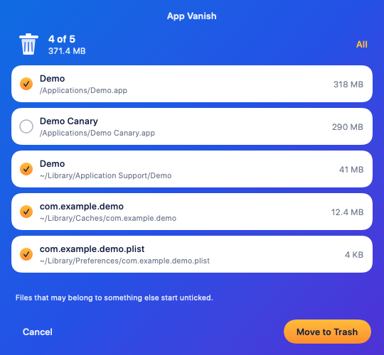

# App Vanish

App Vanish is a small open-source Mac utility. Drop an application on the window and it lists the files that belong to that app. Remove moves the checked files to the Trash.

**Website:** [appvanish.pages.dev](https://appvanish.pages.dev)



It is not affiliated with AppCleaner or FreeMacSoft.

## Install

Download the latest `AppVanish-<version>.dmg` from [Releases](https://github.com/heysidhant/appvanish/releases), open it and drag App Vanish to Applications. Builds are signed with a Developer ID and notarized by Apple.

Or with [Homebrew](https://github.com/heysidhant/homebrew-tap):

```sh
brew tap heysidhant/tap
brew trust heysidhant/tap
brew install --cask appvanish
```

## Build

Open `AppVanish.xcodeproj` and run it, or:

```sh
xcodebuild -scheme AppVanish -configuration Debug -destination 'platform=macOS' -derivedDataPath build test
open build/Build/Products/Debug/AppVanish.app
```

Requires macOS 14 or later.

## Package a DMG

```sh
scripts/make-dmg.sh                              # dist/AppVanish-<version>.dmg, universal
NOTARY_PROFILE=<profile> scripts/make-dmg.sh     # also notarize and staple
```

The script signs with a Developer ID certificate if one is in your keychain. Without one, the build is ad-hoc signed.

## App Store edition

The Mac App Store edition finds files left by apps that were already deleted. It runs in the App Sandbox, so it can't remove apps. Its settings are in `Config/Leftovers.xcconfig`, which leaves the uninstaller's code out of that build. See [docs/APP_STORE.md](docs/APP_STORE.md).

```sh
scripts/make-appstore.sh    # dist/AppStore/AppVanish.pkg
```

## What it looks for

App Vanish reads the app's bundle identifier and name, then checks the usual Library locations:

- the app you dropped, and helper apps that extend its bundle identifier
- Application Support, Preferences, Caches, and Logs
- Saved Application State, Containers, and Group Containers
- LaunchAgents, LaunchDaemons, privileged helpers, and receipts

Apple's own system apps are refused. Review the list before removing anything. Files go to the Trash, so they can be put back.

## Safety

- Files that may belong to something else start unticked: other apps that extend the bundle identifier, files matched only by executable name, and files shared with another installed copy of the same app.
- Running apps are asked to quit, so they can offer to save. App Vanish never force quits. If an app stays open, its files are left in place.
- If an item needs an admin password, App Vanish asks Finder to move it to the Trash, and Finder asks for the password. The first time, macOS asks you to allow App Vanish to control Finder.
- App Vanish makes no network connections.

Some other apps' containers stay hidden until System Settings has Full Disk Access turned on for App Vanish.

## License

MIT. See `LICENSE`.
