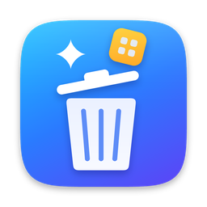

<div align="center">



# App Vanish

**Delete a Mac app and everything it left behind.**

Drop an app on the bin. App Vanish finds its leftover files across your Library,<br>
and moves the ones you choose to the Trash. Free, open source, and nothing leaves your Mac.

[](https://apps.apple.com/app/app-vanish/id6831544178)
[](https://github.com/heysidhant/appvanish/releases/latest)

[](https://github.com/heysidhant/appvanish/stargazers)
[](LICENSE)


[Website](https://appvanish.pages.dev) · [Mac App Store](https://apps.apple.com/app/app-vanish/id6831544178) · [Report a bug](https://github.com/heysidhant/appvanish/issues)


</div>

Dragging an app to the Trash leaves its caches, preferences, containers, launch agents and more behind. App Vanish finds them, shows you each file with its size and location, and lets you decide what goes.

If App Vanish saved you some disk space, a ⭐ helps other people find it.

It is not affiliated with AppCleaner or FreeMacSoft.

## Two editions

| | Full uninstaller | Mac App Store edition |
|---|---|---|
| Removes the app itself | Yes | No, the sandbox doesn't allow it |
| Finds leftovers of an app you drop in | Yes | No |
| Finds leftovers of apps you already deleted | No | Yes |
| LaunchAgents, LaunchDaemons, helpers, receipts | Yes | No |
| Sandboxed | No | Yes |
| Get it | [DMG](https://github.com/heysidhant/appvanish/releases/latest) or Homebrew | [Mac App Store](https://apps.apple.com/app/app-vanish/id6831544178) |

Both are free and built from this repository.

## Install

**Full uninstaller.** Download the latest `AppVanish-<version>.dmg` from [Releases](https://github.com/heysidhant/appvanish/releases), open it and drag App Vanish to Applications. Builds are signed with a Developer ID and notarized by Apple.

Or with [Homebrew](https://github.com/heysidhant/homebrew-tap):

```sh
brew tap heysidhant/tap
brew trust heysidhant/tap
brew install --cask appvanish
```

**Mac App Store edition.** [Get it on the Mac App Store](https://apps.apple.com/app/app-vanish/id6831544178). Updates arrive automatically.

## Build

Open `AppVanish.xcodeproj` and run it, or:

```sh
xcodebuild -scheme AppVanish -configuration Debug -destination 'platform=macOS' -derivedDataPath build test
open build/Build/Products/Debug/AppVanish.app
```

Requires macOS 14 or later.

## Package a DMG

```sh
scripts/make-dmg.sh                              # dist/AppVanish-<version>.dmg, universal
NOTARY_PROFILE=<profile> scripts/make-dmg.sh     # also notarize and staple
```

The script signs with a Developer ID certificate if one is in your keychain. Without one, the build is ad-hoc signed.

## App Store edition

The Mac App Store edition finds files left by apps that were already deleted. It runs in the App Sandbox, so it can't remove apps. Its settings are in `Config/Leftovers.xcconfig`, which leaves the uninstaller's code out of that build. See [docs/APP_STORE.md](docs/APP_STORE.md).

```sh
scripts/make-appstore.sh    # dist/AppStore/AppVanish.pkg
```

## What it looks for

App Vanish reads the app's bundle identifier and name, then checks the usual Library locations:

- the app you dropped, and helper apps that extend its bundle identifier
- Application Support, Preferences, Caches, and Logs
- Saved Application State, Containers, and Group Containers
- LaunchAgents, LaunchDaemons, privileged helpers, and receipts

Apple's own system apps are refused. Review the list before removing anything. Files go to the Trash, so they can be put back.

## Safety

- Files that may belong to something else start unticked: other apps that extend the bundle identifier, files matched only by executable name, and files shared with another installed copy of the same app.
- Running apps are asked to quit, so they can offer to save. App Vanish never force quits. If an app stays open, its files are left in place.
- If an item needs an admin password, App Vanish asks Finder to move it to the Trash, and Finder asks for the password. The first time, macOS asks you to allow App Vanish to control Finder.
- App Vanish makes no network connections.

Some other apps' containers stay hidden until System Settings has Full Disk Access turned on for App Vanish.

## Contributing

Bug reports and pull requests are welcome.

- Found an app whose leftovers App Vanish misses? [Open an issue](https://github.com/heysidhant/appvanish/issues/new) with the app's name and where its files were. That's the most useful report there is.
- Look for issues labelled [`good first issue`](https://github.com/heysidhant/appvanish/labels/good%20first%20issue) or [`help wanted`](https://github.com/heysidhant/appvanish/labels/help%20wanted).
- Run the tests before opening a PR (see [Build](#build)).
- Safety rules come first: anything that might belong to another app must start unticked, and nothing is ever deleted outright.

## More from the maker

[Pixtamer](https://github.com/heysidhant/pixtamer) is a free, open-source Mac app that turns a folder of images into web-ready JPEG, PNG, WebP and AVIF files.

## License

MIT. See `LICENSE`.
